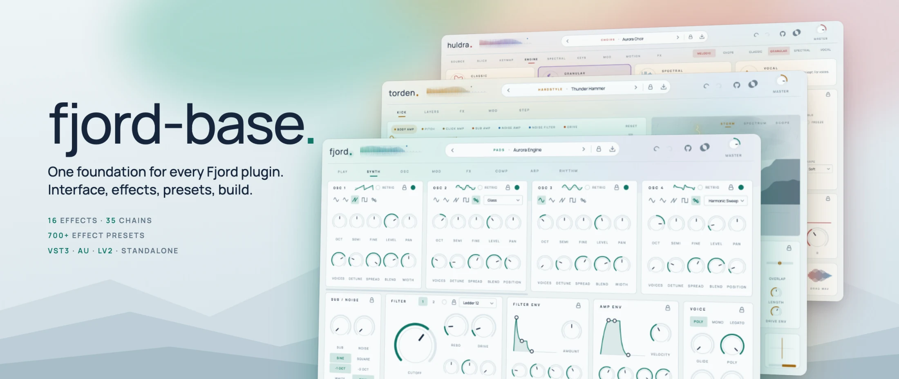
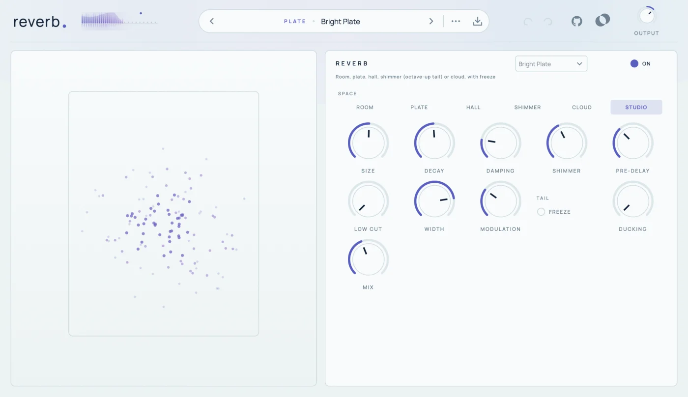
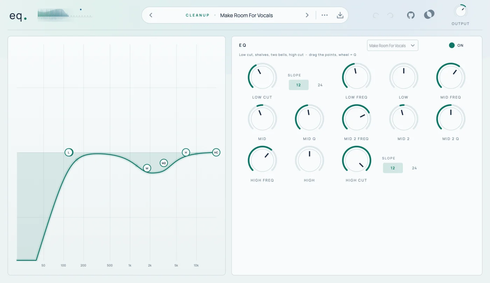
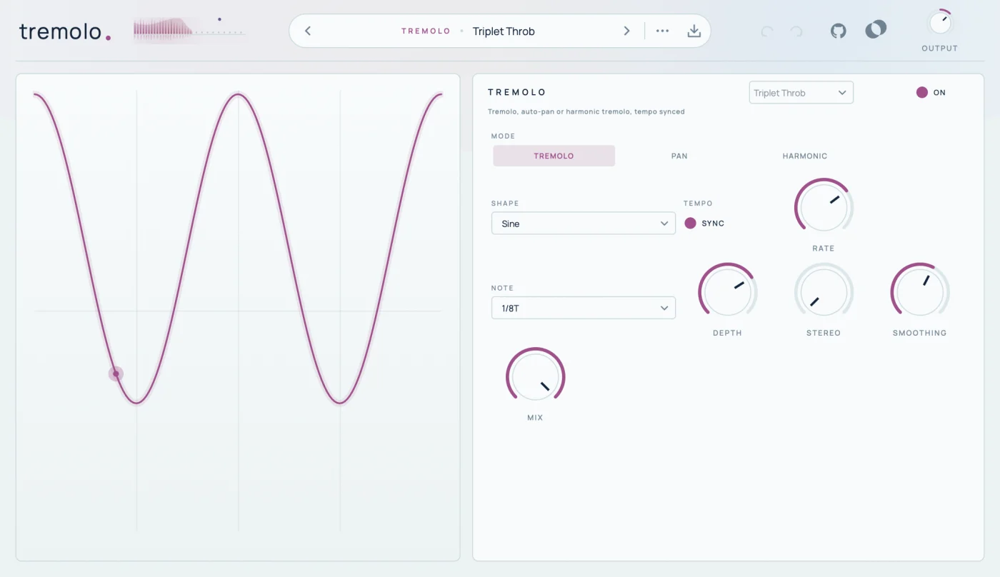

<picture>
  <source media="(prefers-color-scheme: dark)" srcset="docs/screenshots/banner-dark.webp">
  
</picture>

# fjord-base

The shared foundation of the [fjord-sounds](https://github.com/fjord-sounds) plugins ([Fjord](https://github.com/fjord-sounds/fjord),
[Torden](https://github.com/fjord-sounds/torden), [Huldra](https://github.com/fjord-sounds/huldra),
[Hamar](https://github.com/fjord-sounds/hamar)): the user interface,
sixteen effects with more than 700 presets, the preset system, build helpers, CI workflows and a project template.
Standing alone it builds **sixteen effect plugins** – "Fjord Reverb", "Fjord Delay", "Fjord EQ" … – for VST3, Audio Unit,
LV2 and as standalone apps.

[](https://github.com/fjord-sounds/fjord-base/actions/workflows/ci.yml)
[](LICENSE)

> **Made with AI.** fjord-base – the code, the user interface, the tests and all presets – was written entirely by AI
> with Claude, directed by prompts. Nothing is hand-programmed or hand-tuned. The code is open so you can read it, test
> it and judge for yourself; bug reports and pull requests are welcome.

<p>
  <a href="#what-is-in-it">What is in it</a> ·
  <a href="#the-effects">Effects</a> ·
  <a href="#using-fjord-base-in-a-plugin">Using it</a> ·
  <a href="#building">Building</a> ·
  <a href="#documentation">Documentation</a>
</p>

## What is in it

| Part | What it gives a plugin |
|---|---|
| **UI frame** | header with the logo dot that flashes with every note, level meter, preset bar, browser, About panel, undo/redo, light and dark theme, 75–150 % scaling |
| **Controls** | knobs, selectors, sections, keyboard, the look and feel in Manrope – all colours come from the plugin's own `Brand` |
| **FX page** | fifteen effects and a clipper as live tiles, big graphs, per-effect presets, effect chains, Lock FX |
| **Effects** | Saturation, Lo-Fi, Transient, Compressor, Squash, EQ, Filter, Motion, Delay, Reverb, Width, Tremolo, Frequency Shifter, Exciter, Harmonizer, Clipper |
| **Presets** | the preset manager (factory and user presets, categories, tags, favourites, macros, undo), 40+ presets per effect, 35 effect chains |
| **Parameters** | the X-macro table machinery, shared by every plugin and every effect plugin |
| **Build** | CMake helpers (`fjord_add_plugin`), build scripts, JUCE pinning, reusable CI and release workflows |
| **Template** | `tools/new-plugin.py` creates a new plugin that builds and passes its test |

## The effects

<picture>
  <source media="(prefers-color-scheme: dark)" srcset="docs/screenshots/reverb-dark.webp">
  
</picture>

<picture>
  <source media="(prefers-color-scheme: dark)" srcset="docs/screenshots/eq-dark.webp">
  
</picture>

Every effect is also a plugin of its own, with the same header, presets and graph as on the FX page of the instruments.
Each has its own accent colour.

| Effect | What it does |
|---|---|
| Saturation | six curves, bias, tilt tone, oversampling, auto gain |
| Lo-Fi | tape wow and flutter, age, hiss, bit depth, sample-rate reduction |
| Transient | attack and sustain, independent of level |
| Compressor | soft knee, sidechain filter, parallel mix, auto gain |
| Squash | three-band upward and downward compression |
| EQ | low cut, shelves, two bells, high cut – drag the points |
| Filter | ladder or state-variable, envelope per note, LFO |
| Motion | chorus, ensemble, phaser, flanger, doubler, vibrato |
| Delay | clean, tape, grain or diffuse, synced, ducking |
| Reverb | room, plate, hall, shimmer, cloud, studio, freeze |
| Width | stereo width, mono below a crossover, Haas spread |
| Tremolo | tremolo, auto-pan, harmonic tremolo, synced |
| Frequency Shifter | shifts every frequency by the same amount; ring mode |
| Exciter | adds harmonics above a frequency |
| Harmonizer | two pitched voices with detune, delay, feedback |
| Clipper | soft, hard or tape clipping up to a ceiling |

All parameters: [docs/effects.md](docs/effects.md).

<picture>
  <source media="(prefers-color-scheme: dark)" srcset="docs/screenshots/tremolo-dark.webp">
  
</picture>

## Using fjord-base in a plugin

fjord-base is not a package you install: **clone it next to the plugin repositories** and the plugin's CMake picks it up.

```bash
git clone https://github.com/fjord-sounds/fjord-base.git
git clone https://github.com/fjord-sounds/torden.git        # or huldra, hamar, fjord, your own plugin
cd torden && ./build.sh
```

Without the sibling checkout, the plugin's `CMakeLists.txt` downloads the release pinned in `FJORD_BASE_TAG`. A plugin's
CMake is only a few lines (see [cmake/bootstrap.cmake](cmake/bootstrap.cmake) and
[docs/build-and-release.md](docs/build-and-release.md)):

```cmake
fjord_add_plugin(Torden PRODUCT_NAME "Torden" CODE Trdn BUNDLE_ID "com.fjord.torden"
                 PRESETS "presets/Factory/*.torden")
```

A new plugin starts from the template:

```bash
python3 fjord-base/tools/new-plugin.py Skerry Skry --tagline "SYNTH"
```

## Building

Requirements: CMake 3.22+ and a C++20 compiler. JUCE 8 is downloaded by CMake (or put a checkout in `external/JUCE`).

```bash
tools/build-effects.sh                  # macOS: all effect plugins, installed, auval
tools/build-effects.sh reverb delay     # only these
cmake -S . -B build -DCMAKE_BUILD_TYPE=Release -DFJORD_COPY_PLUGIN=OFF && cmake --build build -j8   # elsewhere
```

Test: `cmake --build build --target FjordEffectsTest && ./build/effects/FjordEffectsTest_artefacts/Release/FjordEffectsTest`
renders every effect and every effect preset at 48 and 96 kHz and must print `ALL PASSED`.

## Documentation

The [docs](docs/README.md) describe how a fjord-sounds plugin is built: code, files, README, build, release, design,
presets, tests and the compatibility rules. Start with [getting-started](docs/getting-started.md) or
[new-plugin](docs/new-plugin.md).

## Licences

fjord-base is licensed under the [AGPL-3.0](LICENSE). It uses JUCE (AGPLv3) and the Manrope font (SIL Open Font
License) – see [THIRD_PARTY_NOTICES.md](THIRD_PARTY_NOTICES.md).
